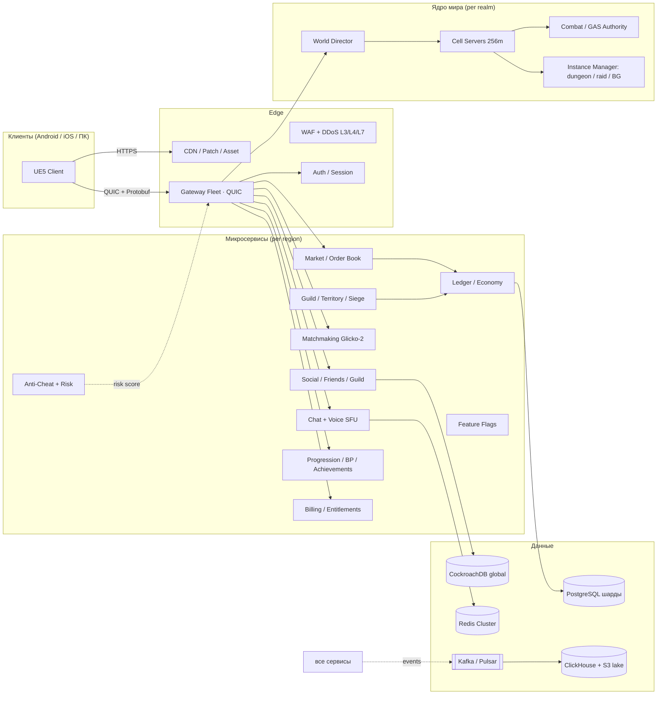

# 08 · Архитектура сервера, сети и Live-инфраструктуры

> Владельцы: Backend Architect, Network Engineer, DevOps Engineer, Anti-Cheat Lead · Версия 1.0
> Связано: `03-gdd.md` §5/§15, `06-economy.md`, `07-mechanics.md` §1/§8, `10-db.md`. Константы: `data/canon.json` → `infrastructure`.

---

## 1. Требования и принципы

| Требование | Решение |
|---|---|
| Авторитетность | Сервер — единственный источник истины для позиций, HP, ресурсов, лута, серебра, предметов, рейтинга |
| «Тысячи игроков онлайн» | 4 000 CCU на реалм × 12 реалмов на регион × 4 региона = **192 000 CCU** проектной ёмкости + эхо-слои городов |
| Задержка | p95 RTT: EU 60 / NA 70 / CIS 80 / APAC 110 мс; «ощущение» боя обеспечивается предсказанием, а не уменьшением авторитета |
| Массовые сражения | 200v200 в отдельном battleground-инстансе с пониженным тикрайтом и LOD-агрегацией |
| Надёжность | 99.95% gateway, 99.95% успешного логина, RPO 5 мин, RTO 30 мин, PITR, мультирегиональный DR |
| Экономическая целостность | Двойная запись, идемпотентность, saga, реконсиляция каждые 5 мин, нулевая толерантность к дюпу |
| Изоляция сбоев | Ни один сбой чата/магазина/аналитики не роняет бой; kill-switch на каждую подсистему |



---

## 2. Каталог микросервисов

| # | Сервис | Язык / рантайм | Состояние | Масштабирование | SLO |
|---|---|---|---|---|---|
| 1 | **Gateway** | Rust (tokio, quinn) | соединения, сессии | stateless, HPA по conn | p99 handshake < 120 мс |
| 2 | **Auth / Session** | Go | JWT/refresh, device binding | stateless + Redis | login success ≥ 99.95% |
| 3 | **World Director** | C++ | карта ячеек, слои, миграции | 1 active + standby на реалм | handoff < 50 мс |
| 4 | **Cell Server** | C++ | 256×256 м ячейка, 30 Гц тик | по ячейке, lease в etcd | tick p99 < 33 мс |
| 5 | **Combat Authority** | C++ | навыки, урон, CC, RNG лута | в.cell-процессе | 0 рассинхронов |
| 6 | **Instance Manager** | Go | данжи/рейды/арены/BG | пул инстансов | старт инстанса < 4 с |
| 7 | **Chat** | Go + Redis Streams | каналы, модерация, rate-limit | шард по каналу | p95 доставка < 500 мс |
| 8 | **Voice SFU** | mediasoup/Go | WebRTC, Opus 32 kbps | по каналу, гео-близость | jitter < 30 мс |
| 9 | **Social** | Go | друзья, враги, группы, LFG | stateless + CRDB | p99 < 150 мс |
| 10 | **Guild / Territory / Siege** | Go | 36 территорий, налоги, осады | 1 на регион + реплика | p99 < 200 мс |
| 11 | **Matchmaking** | Rust | Glicko-2, очереди, backfill | stateless + Redis | p90 < 45 с арена |
| 12 | **Market / Order Book** | Rust + Redis ZSET | книга ордеров, matching | 1 движок на регион | **p99 < 250 мс** |
| 13 | **Ledger / Economy** | Go + PostgreSQL | деньги, предметы, escrow, saga | партиции по `shard_id` | p99 < 120 мс, 0 дюпов |
| 14 | **Progression / BP** | Go | XP, парагон, достижения, титулы | stateless | p99 < 150 мс |
| 15 | **Billing / Entitlements** | Go | DC, покупки, webhooks сторов | stateless + CRDB | p99 < 200 мс, idempotent |
| 16 | **Anti-Cheat / Risk** | Python + Go | risk-score, реплеи, баны | stream + batch | решение < 5 мин |
| 17 | **Analytics Ingest** | Go | Kafka → ClickHouse → S3 | горизонтально | lag < 60 с |
| 18 | **Feature Flags / Config** | Go + etcd | kill-switch, A/B, баланс-конфиги | 3 ноды | применение < 30 с |
| 19 | **Notification / Push** | Go | FCM/APNs, почта, внутриигровые | stateless | p95 < 2 с |
| 20 | **Moderation** | Go + ML-классификатор | жалобы, апелляции, аудит | stateless | апелляция < 24 ч |

**Правило:** сервисы общаются через gRPC (синхрон) и Kafka (события, outbox pattern). Прямой доступ к БД другого сервиса запрещён. Все мутации идемпотентны (`idempotency_key` + UNIQUE).

---

## 3. Сеть и протокол

| Аспект | Решение |
|---|---|
| Транспорт | **QUIC/HTTP3** (UDP/443) как основной; fallback на WSS/443 для сетей с блокировкой UDP; внутри ЦОД — gRPC |
| Кодирование | Protobuf 3 (сообщения), FlatBuffers для больших снапшотов, bit-packing дельт, zstd для сжатия пакетов > 512 B |
| Каналы | `reliable-ordered` (чат, трейд, инвентарь), `reliable-unordered` (навыки, лут), `unreliable` (движение, позиции), `reliable-critical` (ledger-подтверждения) |
| Снапшоты | 20 Гц, только дельты; AOI-радиус 120 м, бакеты 32 м; ≤ 120 видимых акторов; при > 60 игроках — LOD-прокси |
| Бюджет трафика | **14 kbps среднее / 60 kbps пик на мобильного клиента**; 4 000 CCU × 14 kbps ≈ 56 Мбит/с на реалм (внутрь), ×3 на репликацию ≈ 170 Мбит/с |
| Предсказание | клиент предсказывает своё движение и анимацию; сервер присылает `revision`; при расхождении > 0.35 м — мягкая реконсиляция за 0.15 с (без «дёрганья») |
| Lag compensation | сервер хранит 200 мс истории позиций; hit-test делается на момент `client_tick − RTT/2`, но не далее 200 мс |
| Анти-чит сети | подпись клиентского билда, sequence numbers, защита от реплея (nonce + TTL 5 с), rate-limit 120 команд/с, validation КД/ресурса/дистанции/LoS |
| Reconnect | «resume token» 90 с: переподключение без перезагрузки мира, состояние AOI восстанавливается из cell-server |

**Бюджет задержки (EU, p95):** клиентский ввод 8 мс → сеть 30 мс → gateway 3 мс → cell tick ≤ 33 мс → симуляция 4 мс → сеть обратно 30 мс → интерполяция 100 мс (буфер, не задержка реакции) → **визуальный отклик собственной атаки 8 мс**, авторитетное подтверждение ~70 мс.

---

## 4. Общий мир, ячейки и «тысячи игроков»

### 4.1 Геометрия симуляции

- Карта 14.4 × 9.0 км ⇒ ~56 × 36 = **2 016 ячеек по 256 м**; активны только ячейки с игроками (обычно 180–320).
- `Cell Server` владеет ячейкой через lease в etcd (TTL 3 с, heartbeat 1 с); при пересечении границы сущность мигрирует «handoff»: `freeze → serialize(revision) → transfer lease → resume` за < 50 мс.
- `World Director` ведёт карту «какая ячейка у какого воркера», балансирует горячие зоны (Светоград, осада) дроблением на 128 м под-ячейки.
- **Эхо-слои городов:** до 6 копий одного хаба на реалм, автоматическое распределение по плотности; приоритет попадания — друзья/группа/гильдия; ручной выбор в UI; торговля и рынок общие для всех слоёв.

### 4.2 Расчёт ёмкости

| Уровень | Значение | Обоснование |
|---|---|---|
| AOI ≤ 120 акторов × ~14 kbps | ~1.7 Мбит/с на клиента пик | дельта-сжатие + LOD |
| Реалм | 4 000 CCU | 250 активных ячеек × ~16 игроков/ячейку; 30 Гц тик на 24 воркерах |
| Регион | 12 реалмов = 48 000 CCU | общий рынок, рейтинг, гильдии, чат |
| Глобально | 4 региона = **192 000 CCU** | EU/NA/APAC/CIS, кросс-регион только социальный слой |
| Пик launch | 300 000 CCU | +резервные реалмы, +эхо-слои, +очередь входа с «живым» экраном мира |

«Тысячи игроков онлайн» — это не один монолит: игрок одновременно **видит** ≤ 120, **влияет** на общую экономику/рейтинг/территории десятков тысяч, **общается** со всем реалмом. Массовое сражение 200v200 выносится в отдельный инстанс, чтобы не деградировать открытый мир.

### 4.3 200v200 без деградации

| Приём | Эффект |
|---|---|
| Отдельный `Battleground Instance`, тикрайт **20 Гц** | −33% CPU на симуляцию |
| LOD сущностей: полная ≤ 40 м → упрощённая ≤ 80 м → «знамя + имя» ≤ 120 м | −70% трафика |
| Агрегация урона: 400 всплывающих цифр → групповые «суммарные» числа | −85% UI-сообщений |
| Приоритет телеграфов AoE над декоративными VFX | читаемость боя |
| AOI-бакеты 32 м с adaptive rate (дальние сущности 5 Гц вместо 20) | bandwidth ≤ 60 kbps |

---

## 5. Потоки данных (ключевые сценарии)

### 5.1 Каст навыка

```
Client: ABILITY_CAST(skill_id, aim, client_tick, nonce)
  → Gateway (auth, rate-limit, anti-replay)
  → Cell Server (validate: КД, ресурс, дистанция, LoS, CC-состояние, ярус)
  → Combat Authority (RNG, формула урона, статусы, threat, stagger)
  → Snapshot 20 Гц (hp/revision/status_flags) + CAST_RESULT
  → Kafka events: damage, kill, ability_usage → ClickHouse
  → при смерти: LootService (серверный RNG, drop_audit) → Ledger (item_uid) → loot_bag с TTL
```
Отклик: VFX на клиенте сразу (0 мс), авторитетная цифра ≤ 70 мс.

### 5.2 Покупка на рынке (ровно одна транзакция)

```
Order Place → Redis ZSET (горячая книга) + PostgreSQL outbox
Match → Ledger.begin(tx_id, idempotency_key)
  debit(buyer.silver, price + fee) / credit(seller.silver, price − fee)
  BURN(fee)  ·  move item_uid buyer→seller (одна строка владельца)
  INSERT ledger_entry × 2 (debit=credit) · INSERT market_trade · UPDATE OHLC
Ledger.commit → Kafka market.trade → ClickHouse + client notify
```
Ни на одном шаге предмет не существует в двух местах; `UNIQUE(item_uid)`, `EXCLUDE(location)`, триггер баланса проводок (`10-db.md`, `sql/schema.sql`).

### 5.3 Кросс-реалм перевод (Saga)

`WITHDRAW(source, escrow)` → `RESERVE(target)` → `COMMIT(target)` → `RELEASE(source)`; при любом сбое — компенсирующая транзакция; таймаут 15 мин; состояние саги в `saga_state`; реконсиляция каждые 5 мин.

---

## 6. Авторизация, аккаунты, безопасность

| Аспект | Решение |
|---|---|
| Вход | OIDC: Google Play Games / Apple Game Center / Steam / Epic / email+пароль; серверный `code exchange`, никогда не доверяем клиентскому «я вошёл» |
| Токены | JWT access 15 мин (audience = realm), refresh 30 дней с rotation, привязка к `device_id` и аттестации; revoke-лист в Redis |
| Права | RBAC на сервисах + `entitlements` в CockroachDB; DC-баланс проверяется billing-сервисом при каждой трате |
| MFA / защита | обязательная для аккаунтов с покупками > $100/мес, опциональная всем; лимит попыток; алерт при смене устройства |
| Шифрование | TLS 1.3 наружу, mTLS внутри ЦОД, AES-256 at rest, KMS с ротацией 90 дней; PII отдельно от игровых данных |
| DDoS | anycast L3/L4 (1.2 Тбит/с ёмкость), WAF L7, proof-of-work challenge на handshake при атаке, rate-limit по IP/аккаунту/устройству |
| GDPR/COPPA | минимизация, право на удаление (ERASURE), regional data residency, возрастной гейт, журнал согласий; лог чата — хеш, не PII |
| Анти-чит | серверная валидация 11 инвариантов (`07-mechanics.md` §13), risk-score 0–100, реплеи боёв 7 дней, shadowban-пулы, апелляция 24 ч |

---

## 7. Матчмейкинг

Glicko-2 с RD и volatility; отдельные пулы по региону, типу ввода и режиму; расширение допуска MMR `±25 → ±300` каждые 15 с; защита от «синхронного входа» (anti-boost по графу); backfill с толерансом ±120 и компенсацией жетонов; приоритет группы и роли (2 танка / 2 лекаря — рекомендация, не жёсткая блокировка); SLO p90 < 45 с арена / < 120 с BG; деградация: при низком пуле — «тренировочный бой с ботами» только в неранговых режимах, никогда в рейтинге.

---

## 8. Наблюдаемость, аналитика, SLO

| Слой | Инструмент | Что смотрим |
|---|---|---|
| Метрики | OpenTelemetry → Prometheus → Grafana | тикрайт, p95 RTT, AOI size, cell handoff, market p99, login success, CCU, crash-free |
| Логи | Loki / Elasticsearch, структурированный JSON, retention 30 дн. | ошибки сервисов, CAST_REJECTED, ledger anomalies |
| Трейсы | Jaeger / Tempo, W3C trace-context | сквозной трейс «каст → урон → лут → ledger» |
| События | Kafka → ClickHouse (≤ 60 с lag) → S3 Parquet | 240 типов событий, воронки, D1/D7/D30, экономика, баланс классов |
| Алерты | PagerDuty, 4 уровня | PI > 108, sf < 1.02, дюп-алерт P1, p95 RTT > 120 мс, error budget burn |
| SLO | 99.95% gateway / login; market p99 < 250 мс; chat p95 < 500 мс; voice jitter < 30 мс | еженедельный error-budget отчёт, мораторий на релизы при выгорании > 50% |
| Kill-switch | feature flags на систему | отключить чат/рынок/голос/магазин/данж без рестарта ядра боя |
| Инциденты | runbook на каждый сервис, on-call 24×7, postmortem без поиска виноватых за 72 ч | ежемесячные chaos-учения (потеря cell,split-brain Kafka, отказ региона) |

---

## 9. DevOps, CDN, релизы

| Контур | Решение |
|---|---|
| Оркестрация | Kubernetes 1.31, 4 региона × 3 AZ, Cluster API, HPA/KEDA по CCU и queue depth, PDB, topology spread |
| IaC | Terraform + Helm/ArgoCD (GitOps); любое изменение инфраструктуры — PR с планом |
| CI | сборка C++ (Unreal dedicated server) + Go/Rust, юнит + интеграционные + нагрузочные тесты, SAST/DAST, подпись артефактов (cosign) |
| Релизы | канарейка 1% → 10% → 50% → 100%, авто-откат по SLO, feature flags, «зелёный» деплой без даунтайма (stateful cell — rolling c handoff) |
| CDN | 3 вендора multi-CDN, 220 PoP, стартовый пакет 2.2 ГБ, чанки по 64 МБ, дельта-патч ≤ 120 МБ/нед, Brotli/zstd, подпись манифеста, предзагрузка «первого региона» |
| Патчер | фоновые чанки, докачка по Wi-Fi, приоритет «вход в мир», проверка целостности, откат на предыдущий манифест |
| Бэкапы | PostgreSQL PITR каждые 5 мин (WAL), snapshot 6 ч, кросс-регион реплика, quarterly restore-drill; Redis — только кэш, восстанавливается |
| DR | RPO 5 мин / RTO 30 мин; при потере региона — поднять реалмы в соседнем, экономическая компенсация игрокам косметикой по публичной формуле |
| Chaos | ежемесячно: kill cell-server, network partition, Kafka lag, отказ billing, «день попыток дюпа» в staging |

### Стоимость инфраструктуры (модель, без маркетинга)

| CCU | Вычисление | Трафик | Хранилище/прочее | $/мес |
|---|---|---|---|---|
| 50 000 | 320 воркеров | 1.9 ПБ/мес egress | PG/CRDB/ClickHouse/SFU | ~$410 000 |
| 150 000 | 900 воркеров | 5.6 ПБ/мес | +репликация | ~$1 090 000 |
| 300 000 | 1 750 воркеров | 11.3 ПБ/мес | +резервные реалмы | ~$2 050 000 |

При ARPDAU $0.14 и 300K CCU (≈2.1M DAU) выручка ~$294K/день ⇒ инфраструктура ~2.3% выручки. Детализация — `12-budget.md` / `tools/financial_model.py`.

---

## 10. Матрица отказов и деградации

| Отказ | Поведение игрока | Техническое действие |
|---|---|---|
| Chat недоступен | бой идёт, иконка «чат временно недоступен» | отключение сервиса флагом, ретраи с backoff |
| Market недоступен | ордера замораживаются, новые не принимаются, предметы в escrow не теряются | Redis→PG восстановление книги, объявление |
| Cell-server упал | игроки ячейки за 2 с переносятся в соседнюю с тем же `revision` | lease expired → World Director перераспределяет |
| Gateway региона | reconnect token → соседний PoP без выхода из мира | anycast перемаршрутизация |
| Billing недоступен | покупки приостановлены, **уже купленная косметика остаётся** | idempotent webhook retry 72 ч |
| Пул матчмейкинга пуст | неранговый режим предлагает бой с ботами | рейтинг не начисляется |
| Ledger-расхождение | затронутые аккаунты freeze на 5 мин, остальные играют | авто-реконсиляция + P1 алерт |
| Потеря региона | вход через соседний регион с кросс-прогрессией | DR-план, публичный статус |

---

## 11. Критерии приёмки (Go/No-Go для софт-ланча)

1. 4 000 ботов-клиентов на реалм: p95 RTT ≤ 80 мс, tick p99 ≤ 33 мс, 0 рассинхронов инвентаря, bandwidth ≤ 60 kbps пик.
2. 200v200 баттлграунд: 20 Гц, p95 RTT ≤ 110 мс, 0 потерь авторитетных событий урона.
3. 1 000 000 Market-операций в нагрузочном тесте: p99 < 250 мс, 0 дублей `item_uid`, SUM(debit)=SUM(credit).
4. Chaos-тест «день дюпов»: 200 искусственных попыток → 0 принятых, алерт < 5 мин.
5. DR-drill: отказ AZ → восстановление < 30 мин, RPO ≤ 5 мин.
6. 100% сервисов имеют runbook, kill-switch, SLO и дашборд; error budget за 30 дней не выгорел.
7. Публичный статус-лист и еженедельный экономический отчёт работают до запуска.
