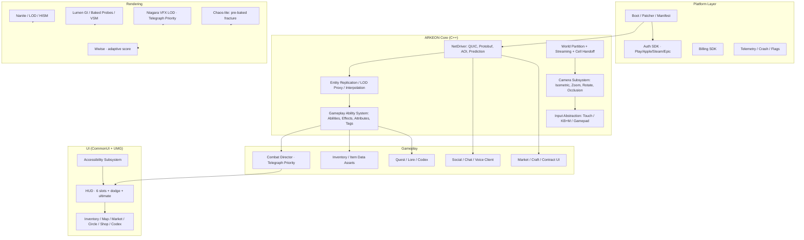

# 09 · Архитектура клиента (Unreal Engine 5.6)

> Владельцы: Mobile Architect, Unity/Unreal Developer, UI/UX Designer, Concept/3D Artist, DevOps · Версия 1.0
> Связано: `03-gdd.md` §4/§14, `07-mechanics.md`, `08-server.md`. Константы: `data/canon.json`.

---

## 1. Целевые платформы и бюджеты производительности

| Профиль | Устройства | Рендер | FPS | Память | Сеть |
|---|---|---|---|---|---|
| **Ultra (ПК)** | RTX 3070+ / 32 ГБ | Lumen HW RT, Nanite, VSM, 4K, TSR | 60–120 | ≤ 8 ГБ | 60 kbps |
| **High (ПК / флагман)** | RTX 2060, Snapdragon 8 Gen 2, A16 | Lumen SW / зонды, Nanite, 1440p/1080p | 60 | ≤ 4.5 ГБ | 45 kbps |
| **Medium** | Snapdragon 778G, A13, 6 ГБ | запечённый GI + динамические зонды, 1 каскад теней, 900p | 30–45 | ≤ 3.2 ГБ | 25 kbps |
| **Low / «Лёгкий режим»** | 4 ГБ ОЗУ, Android 10 | без динамических теней, LOD2, упрощённые VFX, 720p | 30 | ≤ 2.2 ГБ | 14 kbps |

**Жёсткие бюджеты:** стартовый пакет ≤ **2.2 ГБ** (Android APK/AAB + OBB, iOS App Thinning), дельта-патч ≤ 120 МБ/нед, cold-start до главного меню ≤ 6 с на Medium, вход в мир ≤ 8 с, 30 мин непрерывной игры без падения FPS > 15% и нагрева поверхности > 3 °C, crash-free sessions ≥ 99.6%, ANR < 0.1%, энергопотребление ≤ 420 мА·ч/ч на Medium.

| Подсистема | Бюджет кадра (Medium, 33.3 мс) |
|---|---|
| Game thread (GAS, AI-интерполяция, UI) | ≤ 8 мс |
| Render thread | ≤ 10 мс |
| RHI / GPU | ≤ 12 мс |
| Сеть / десериализация | ≤ 2 мс |
| Аудио / прочее | ≤ 1.3 мс |

---

## 2. Модульная структура клиента

**Модули (UE plugins):** `ArkeonCore`, `ArkeonNet`, `ArkeonAbilities`, `ArkeonCamera`, `ArkeonUI`, `ArkeonEconomy`, `ArkeonSocial`, `ArkeonTelemetry`, `ArkeonPlatform`. Границы модулей проверяются на CI (запрет циклических зависимостей); Blueprint используется только для презентации/UI, вся логика — C++ + Data Assets.

---

## 3. Графика: AAA на ПК и честный mobile

| Технология | Ultra / High ПК | High mobile | Medium / Low mobile |
|---|---|---|---|
| **Nanite** | ✔ полный | ✔ (кластеризация, 1M три/кадр) | ✘ → статические LOD0/1/2 + HISM |
| **Lumen** | HW RT + Screen Probes | Software Lumen на флагманах (опционально) | запечённый GI (Lightmass) + Volume Probes + Dynamic Sky Light |
| Тени | Virtual Shadow Maps | 2 каскада | 1 каскад / blob-shadows |
| Отражения | RT reflections / SSR | SSR-lite | кубические карты + планарные отражения для воды |
| Постобработка | TSR, DOF, Motion Blur (настраиваемо) | TSR, лёгкий bloom | FXAA, bloom ½ res |
| VFX (Niagara) | полный, 400 частиц/эффект | 200 | 60 + impostor-спрайты для дальних |
| Разрушаемость | Chaos fracture runtime | предпечённые фрагменты | state-bit + готовая «обломочная» меш |

**VFX-приоритет (обязателен):** `телеграф босса > реакция > урон игрока > лут > декор`. При просадке FPS движок сначала отключает декоративные частицы, затем снижает тени, **никогда** — контрастность телеграфов и AoE-маркеров. Это правило зашито в `ArkeonScalability` и проверяется автоматическим фрейм-тестом.

**Свет и время суток:** 6 состояний погоды × 90-минутный цикл; на мобильных — 8 запечённых lighting scenarios + интерполяция зондов, без пересчёта Lumen в реальном времени. Эмиссивные Светочи всегда имеют одинаковую читаемую яркость во всех профилях (геймплейный ориентир).

**Художественный пайплайн:** Concept → blockout → high-poly (ZBrush) → bake → Nanite-friendly retopo → 4K PBR → LOD-цепочка → VFX → lighting pass → acceptance на 4 профилях. Атлас текстур по биомам, виртуальные текстуры, streaming pool 512 МБ (Low 256 МБ).

---

## 4. Камера и ввод

| Возможность | Реализация |
|---|---|
| Изометрия | Ортографическая камера с лёгким перспективным смешиванием, FOV 28°, pitch 48° (35–62°), arm length 8–26 м |
| Зум | Плавный с инерцией 0.18 с, pinch на тач, колесо на ПК, 5 пресетов; авто-отъезд на боссах и в 200v200 |
| Поворот | 360°; ПК — Q/E со snap 45°, тач — два пальца; ввод джойстика всегда пересчитывается в camera-space |
| Occlusion | dither-fade препятствий 0.25 с + силуэт игрока через стены; подземья — маркер яруса |
| Lock-on | soft aim, «камера угрозы» при телеграфе, приоритет босса/адда по `threat_tag` |
| Тач | плавающий джойстик, 6 слотов ≥ 44 dp, свайп-додж, тап-цель, настраиваемая раскладка, one-hand mode |
| ПК/геймпад | WASD + мышь, 1–6/Q/E/Space/R, полный ремап; геймпад — отдельный HUD-лейаут |
| Доступность | reduce motion, 3 профиля дальтонизма, крупный текст 130%, субтитры с направлением, «медленные телеграфы» +150 мс, вибро-дубль AoE |

---

## 5. Сетевой клиент

| Компонент | Правило |
|---|---|
| Подключение | QUIC/443, fallback WSS/443; 3 гео-энда с выбором по RTT; resume-token 90 с |
| Приём | 20 Гц дельта-снапшоты, Protobuf/FlatBuffers, zstd, ring buffer 100 мс интерполяции |
| AOI | подписка на бакеты 32 м в радиусе 120 м; сервер присылает только видимые сущности; ≤ 120 акторов |
| LOD сущностей | ≤ 40 м полная модель+анимация, ≤ 80 м упрощённая, ≤ 120 м «знамя + имя + HP-бар»; прислужники агрегируются |
| Предсказание | своё движение + анимация + VFX каста; реконсиляция при расхождении > 0.35 м; чужие — только интерполяция |
| Отправка | `ABILITY_CAST / MOVE / INTERACT / TRADE / ORDER` — намерения, **не результаты**; 120 команд/с лимит |
| Reconnect | «Мир на паузе» ≤ 3 с, восстановление AOI без загрузочного экрана, состояние инвентаря из авторитетного снапшота |
| Офлайн | только главное меню, Кодекс, гардероб, настройки, предпросмотр косметики; бой и рынок недоступны |
| Безопасность | подпись билда, nonce/sequence, certificate pinning, аттестация устройства, шифрование локального кэша |

---

## 6. GAS: боевая логика на клиенте и сервере

| Класс GAS | Назначение |
|---|---|
| `UArkeonAttributeSet` | HP, Shield, Resource, ATK, DEF, Crit, Elemental Resist, MoveSpeed, IP — реплицируются с сервера |
| `UGameplayAbility` (48+) | по навыку из `data/classes.json`; теги `Cooldown.*`, `Cost.*`, `Cast.*`, `Break`, `Reaction.*`, `Telegraph.*` |
| `UGameplayEffect` | урон, DoT, CC, щиты, баффы, реакции; `Infinite`/`Duration`/`Instant`; политика стаков и DR контролируются на сервере |
| `GameplayCue` | VFX/аудио; клиент проигрывает сразу, но урон подтверждается сервером |
| `AbilityTask` | телеграфы, зарядка, канал, комбо-окна, animation-cancel (только последние 0.12 с) |
| `FArkeonAbilitySpec` | Data Asset, сгенерированный из `data/classes.json` (`tools/gen_docs.py` + build-time codegen); **коэффициенты не хардкодятся в Blueprint** |

Dedicated server использует тот же C++ GAS-код (без рендера) — это исключает расхождение логики клиент/сервер. Клиентская «предсказанная» анимация не имеет права менять AttributeSet.

---

## 7. UI/UX (CommonUI + UMG)

- **Иерархия HUD:** HP/ресурс/додж/ультимейт → телеграфы → 6 навыков → цель и бары → миникарта/компас → чат → уведомления экономики.
- **Правило трёх тапов:** любая цель сессии из главного экрана ≤ 3 действия; «сравнение предмета» — одним тапом без открытия инвентаря.
- **Мобильный бюджет:** ≤ 14% площади экрана под постоянный HUD в бою, все элементы ≥ 44 dp, safe-area под жест/вырез, ни одного модального окна во время телеграфа.
- **Экраны:** Инвентарь (60 слотов, массовые операции с серверным preview), Карта (слои, офлайн-кэш), Рынок (книга, спред, OHLC 30 дн, калькулятор «крафтить или купить»), Круг (друзья/клан/гильдия/LFG/голос), Кодекс, Магазин (предпросмотр на своём персонаже, пометка «не влияет на силу»), Настройки.
- **Локализация:** 14 языков, строковые таблицы + ICU-плюрали, RTL для AR, CJK-шрифты, максимальная длина строки в UI ≤ 140% от EN (проверяется линтером), никакого текста в Blueprint/текстурах.
- **Дизайн-токены:** цвет + форма для редкости и зон закона (дальтонизм), единая иконография 7 Клятв, анимация лучей из `01-title.md`.

---

## 8. Контент, ассеты и патчинг

| Контур | Решение |
|---|---|
| Data-driven | `data/canon.json`, `data/classes.json`, `data/world.json` → build-time codegen в Data Assets + JSON-валидация (`tools/verify_canon.py` в CI) |
| Локализация | `Localization Dashboard`, псевдолокализация на CI, перевод в TMS,hotfix строк через CDN без пересборки билда |
| Кукинг | чанки 64 МБ по регионам + «первый регион» в стартовом пакете; IoStore/IoDispatcher; асинхронная загрузка без экранов |
| Патчер | манифест с подписью, zstd-дельты, докачка по Wi-Fi, приоритет входа в мир, откат на предыдущий манифест |
| Hotfix | конфиги баланса/флаги/строки — через Config Service за 30 с; **боевые коэффициенты — только через PTR + патчноут за 14 дней** (P3) |
| Аудио | Wwise: 3D-позиционирование, адаптивная партитура по состоянию Светочей, 12 дБ динамический диапазон для телефона, ducking под телеграфы, VO на 14 языков |

---

## 9. Платформенная интеграция

| Платформа | Обязательное |
|---|---|
| Android | Google Play Games Services, Play Integrity, billing v7, AAB, Dynamic Delivery, Adaptive Performance, Vulkan, 64-bit, foreground service для voice, уведомления FCM |
| iOS | Game Center, App Attestation/DeviceCheck, StoreKit 2, App Thinning, Metal, background audio permission, APNs, ATT для UA-атрибуции |
| ПК | Steamworks / Epic EOS, собственный лаунчер, achievements, cloud save (= серверный профиль), overlay-совместимость, anti-cheat без kernel-драйвера |
| Кросс | единый `account_id` в CockroachDB, кросс-прогрессия и кросс-плей; выбор «ввода» для рангового PvP; трансфер косметики между платформами через entitlements |
| Приватность | минимум разрешений, явное согласие на микрофон/запись голоса, экран «Данные и приватность», удаление аккаунта в 1 тап (GDPR) |

---

## 10. Телеметрия, краши, флаги

240 типов событий (`ability_cast`, `damage_taken`, `drop`, `market_order`, `guild_tax`, `frame_time`, `thermal`, `reconnect`, `crash`, `purchase`…), батчинг 30 с / 100 событий, офлайн-очередь 5 МБ, PII-хэширование на клиенте, opt-out для некритичной аналитики. Crash: символизация стеков Android/iOS/ПК, автоматический тикет при > 0.05% crash-free drop. Feature flags: A/B только на UX/онбординг/монетизацию (не на боевую формулу), bucketing по `account_id`, kill-switch на систему.

---

## 11. Тестирование и перфоманс-гейты

| Контур | Объём |
|---|---|
| Device farm | **220 устройств**: 90 Android (4 профиля), 40 iOS, 30 ПК-конфигураций, 60 «пограничных» (4 ГБ, старые GPU, слабая сеть) |
| Автотесты | 2 400 юнит-тестов GAS/Net/UI, 380 интеграционных, 120 сетевых сценариев с 200 мс RTT и 3% потерь |
| Perf-гейты в CI | cold start, frame time p95, память, трафик, нагрев, battery, crash-free — регрессия > 5% блокирует мерж |
| Сетевые тесты | 4 000 бот-клиентов на реалм, reconnect-шторм, split-brain, UDP-блокировка → WSS fallback |
| UX-тесты | 12 еженедельных playtest-сессий по 8 игроков, eye-tracking на мобильном HUD, «одна цель за сессию» |
| Сертификация | PEGI/ESRB/RARS, Google Play/App Store review-чеклист, accessibility WCAG 2.2 AA |

---

## 12. Критерии приёмки клиента

1. 4 профиля графики дают заявленные FPS/память на 220 устройствах; VFX-приоритет телеграфов не нарушается ни на одном.
2. Стартовый пакет ≤ 2.2 ГБ, недельный патч ≤ 120 МБ, cold start ≤ 6 с, вход в мир ≤ 8 с.
3. p95 frame time ≤ 16.7 мс на High и ≤ 33.3 мс на Medium в бою с 60 акторами.
4. Ноль client-authoritative изменений HP/инвентаря/серебра: аудит GAS подтверждает, что AttributeSet меняется только из репликации.
5. 14 локализаций проходят псевдолокализацию и RTL-рейд; ни одного текста в Blueprint.
6. Каст ощущается мгновенно (VFX 0 мс), авторитетное подтверждение ≤ 70 мс, reconnect ≤ 3 с без загрузочного экрана.
7. Косметический магазин физически не имеет полей статов в Data Asset — линтер `verify_canon.py` это проверяет.
