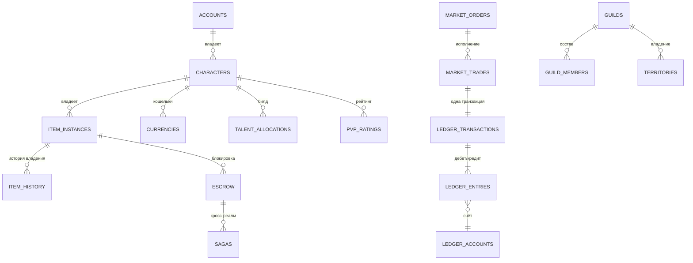

# 10 · Структура базы данных и модель данных

> Владельцы: Backend Architect, Economy Designer, DevOps · Версия 1.0
> Исполняемая схема: **`sql/schema.sql`** (81 таблица + 4 VIEW + 3 триггера + партиции). Связано: `06-economy.md` §8, `08-server.md` §2/§5, `07-mechanics.md`.

---

## 1. Три контура хранения

| Контур | Технология | Что хранит | Почему |
|---|---|---|---|
| **GLOBAL** | CockroachDB, multi-region (3+ реплики, consensus) | аккаунты, identities, устройства, сессии, премиальный кошелёк, billing, entitlements, баны, согласия, флаги, конфиг-версии | нужен глобально консистентный аккаунт и кросс-прогрессия между регионами; переживает потерю региона |
| **REALM** | PostgreSQL 17, 12 шардов на регион (primary + 2 sync-реплики) | персонажи, предметы, **ledger**, рынок, контракты, гильдии, территории, чат, мир | игровое состояние привязано к реалму; локальные транзакции дают p99 < 120 мс и строгую двойную запись |
| **ANALYTICS** | Kafka → ClickHouse (горячие 90 дней) → S3 Parquet (бессрочно, обезличено) | 240 типов событий, телеметрия, баланс, экономика, A/B | OLAP отделён от OLTP; ни один отчёт не нагружает боевой шард |

**Пограничное правило:** сервис имеет доступ только к своим таблицам; `arkeon_client` — read-only роль на отчётные VIEW; прямых SQL-запросов из клиента не существует в принципе. Redis Cluster — **только кэш** (сессии, горячая книга ордеров, AOI, rate-limit, лидерборды), никогда не источник истины для предметов и валют.



---

## 2. Каталог таблиц (по доменам)

| Домен | Таблицы | Назначение |
|---|---|---|
| **GLOBAL** (12) | `accounts`, `account_identities`, `account_devices`, `sessions`, `premium_wallet`, `billing_transactions`, `entitlements`, `bans`, `consent_log` | вход, устройства, платежи, права, баны |
| **GLOBAL-ops** (включено в 12) | `gdpr_erasure_queue`, `feature_flags`, `config_versions` | соответствие, kill-switch, версионирование баланс-конфигов |
| **Персонажи** (6) | `realms`, `characters`, `character_stats`, `currencies`, `skill_loadouts`, `talent_allocations` | ядро персонажа и билд |
| **Прогрессия** (10) | `paragon_allocations`, `reputations`, `achievements`, `collections`, `titles`, `battlepass_progress`, `pvp_ratings`, `matchmaking_queue`, `matches` + `match_participants` | 8 осей прогрессии и матчмейкинг |
| **Предметы** (5 + escrow) | `item_definitions`, `item_instances`, `item_history`, `drop_audit`, `loot_bags`, `(+escrow)` | уникальный UID, аффиксы, заточка, прочность, аудит дропа |
| **Ledger** (7) | `ledger_accounts`, `idempotency_keys`, `ledger_transactions`, `ledger_entries`, `escrow`, `sagas`, `saga_steps` | деньги, предметы, двойная запись, саги |
| **Экономика** (10) | `market_orders`, `market_trades`, `market_ohlc`, `auctions`, `auction_bids`, `trade_offers`, `trade_offer_items`, `contracts`, `craft_jobs`, `gathering_nodes` | рынок, аукцион, трейд, контракты, крафт, спавн |
| **Социал** (13) | `clans`, `clan_members`, `guilds`, `guild_ranks`, `guild_members`, `guild_bank_log`, `alliances`, `alliance_members`, `guild_treaties`, `friends`/`enemies`/`parties`/`party_members` | кланы, гильдии, альянсы, связи |
| **Территории** (5) | `territories`, `territory_ownership_log`, `guild_wars`, `sieges`, `guild_rating` | 36 территорий, осады, рейтинг |
| **Коммуникации** (4 + партиция) | `chat_channels`, `chat_messages` (партиции), `chat_moderation`, `voice_sessions` | чат и голос |
| **Мир** (4) | `world_object_state`, `world_events`, `world_state_votes`, `region_state` | разрушаемые объекты, события, мировое голосование |
| **Audit** (3 + партиция) | `anti_cheat_flags`, `replay_index`, `analytics_events` (партиции) | анти-чит, реплеи, телеметрия |
| **Views** (4) | `v_ledger_imbalance`, `v_item_owner_conflicts`, `v_economy_daily`, `v_top_silver_holders` | реконсиляция, инфляция, концентрация |

**Ключи:** суррогатные `UUID`/`UUIDv7` (item_uid генерируется сервером), `realm_id SMALLINT` — ключ шардирования, `account_id` — логическая ссылка на GLOBAL (без физического FK через БД), `season_id` — во всех сезонных таблицах. Индексы: btree под OLTP-запросы, GIN/trgm под поиск имён и JSONB, BRIN под временные ряды, partial index под «открытые» ордера и активные сессии.

---

## 3. Консистентность и транзакции

| Сценарий | Модель |
|---|---|
| Каст навыка / урон | in-memory cell state + асинхронная фиксация событий; autoritative revision, без distributed transaction |
| Лут | `BEGIN` → `INSERT drop_audit` → `INSERT item_instances` → `INSERT item_history` → `INSERT ledger_entries(debit/credit)` → `COMMIT` (одна транзакция, один шард) |
| Покупка на рынке | `BEGIN` → `SELECT … FOR UPDATE` на item_uid и два кошелька → матчинг → проводки → `UPDATE market_orders` → `INSERT market_trades` → outbox-событие → `COMMIT` |
| Прямой трейд | обе стороны подтверждают; одна транзакция, `UNIQUE(item_uid)` в `trade_offer_items` исключает двойной предмет |
| Кросс-реалм перевод | **Saga**: `sagas` + `saga_steps` с компенсирующими действиями; escrow до подтверждения; таймаут 15 мин |
| Billing | `idempotency_key` на webhook стора; повтор webhook'а возвращает кешированный результат, а не второй платёж |
| Конфиг/баланс | `config_versions` с checksum; применяется через Feature Flags, публикуется в патчноуте за 14 дней |

**Outbox pattern:** любая мутация пишет и состояние, и событие в `outbox` одной транзакцией; relay публикует в Kafka; потребители идемпотентны по `event_id`. Это даёт «at-least-once события + exactly-once эффекты на предметах».

**Уровни изоляции:** `READ COMMITTED` для чтения, `SERIALIZABLE` только для матчинга ордеров и saga-commit; `SELECT … FOR UPDATE ORDER BY item_uid` — обязательный порядок захвата блокировок (защита от deadlock при встречных ордерах).

---

## 4. Предметная модель (сердце анти-дюпа)

`item_instances` — единственная таблица, где предмет «существует». Поля: `item_uid` (PK), `def_id`, `owner_id`, `location` (enum из 10 состояний), `container_ref`, `bind`, `rarity`, `item_power`, `affixes/sockets/runes/gems` (JSONB), `set_id`, `enchant_level`, `reroll_count`, `durability/max_durability`, `repair_count`, `created_by`, `revision`, `row_hash`.

**Пять инвариантов:**

| № | Инвариант | Механизм в SQL |
|---|---|---|
| **I1** | Один UID = один владелец = одна локация | `UNIQUE(item_uid)`, `UNIQUE(item_uid) WHERE location IN (…escrow…)`, `item_no_double_escrow` |
| **I2** | Проводка сбалансирована | `CONSTRAINT TRIGGER ledger_balance_check` (DEFERRABLE INITIALLY DEFERRED) вызывает `fn_validate_ledger`: `SUM(debit)=SUM(credit)` |
| **I3** | Баланс неотрицателен | `CHECK (balance >= 0)` + `BEFORE UPDATE` триггер `fn_wallet_nonnegative` |
| **I4** | Мутация идемпотентна | `idempotency_keys.idempotency_key PRIMARY KEY`, `ledger_transactions.idempotency_key UNIQUE` |
| **I5** | Клиент не пишет | роль `arkeon_client` = read-only VIEW; все записи — от имени сервисов с mTLS |

Дополнительно: `item_history.hash = HMAC(secret, prev_hash || row)` — цепочка истории владения, которую нельзя переписать «посередине». `drop_audit.rng_seed` фиксирует серверный RNG лута, поэтому «подкрутить дроп» клиент не может, а спор разбирается по `drop_id`.

**Реконсиляция каждые 5 минут:**
```sql
SELECT * FROM realm.v_ledger_imbalance;          -- должно быть 0 строк
SELECT * FROM realm.v_item_owner_conflicts;      -- должно быть 0 строк
SELECT * FROM realm.escrow WHERE released_at IS NULL AND expires_at < now() - interval '15 min';
SELECT * FROM realm.sagas WHERE state IN ('started','reserved') AND updated_at < now() - interval '15 min';
```
Любая непустая выборка → P1-алерт, freeze затронутых аккаунтов, автоматический откат по журналу и публичный инцидент-отчёт.

---

## 5. Экономические отчёты (executable)

| Отчёт | Источник | Частота | Потребитель |
|---|---|---|---|
| `PI`, `R_t`, `sink/faucet` | `v_economy_daily` + `tools/economy_sim.py` | 1 ч / публично 1 нед. | Economy Designer |
| Топ-1% держателей Серебра | `v_top_silver_holders` (NTILE(100)) | ежедневно | анти-RMT |
| Граф «звезда» контрагентов | `market_trades`, `trade_offers`, `guild_bank_log` | каждые 6 ч | Anti-Cheat |
| OHLC 30 дней | `market_ohlc` | 1 ч | игроки, публичный API |
| Drop-распределение | `drop_audit` по `result_rarity` | ежедневно | баланс + публичный отчёт вероятностей |
| Доля crafted-предметов | `item_instances.created_by LIKE 'craft:%'` | ежедневно | KPI ≥ 92% |
| BURN по зонам | `ledger_transactions(kind='burn')` + `loot_bags` | ежедневно | Economy Designer |

---

## 6. Партиционирование, retention, приватность

| Таблица | Партиции | Retention |
|---|---|---|
| `chat_messages` | RANGE по `created_at`, ежедневно | 30 дней в PG → S3 (только хеш текста) |
| `analytics_events` | RANGE по `created_at`, ежедневно | 90 дней в ClickHouse → Parquet бессрочно, обезличено |
| `ledger_entries` | по месяцам + BRIN | 5 лет (аудит экономики), затем агрегат |
| `item_history` | по `item_uid` hash при > 8M строк | бессрочно для существующих предметов |
| `replay_index` | — | 7 дней |
| `voice_sessions` | — | метаданные 30 дней, запись 72 ч и только при согласии |

**GDPR / COPPA:** `consent_log` на каждую цель; `gdpr_erasure_queue` удаляет PII из GLOBAL, а игровые события остаются с `account_hash`; `chat_messages` хранит `body_hash`, а не текст; дети проходят age-gate; данные резидентны региону (EU — Frankfurt, CIS — Helsinki/Frankfurt по решению DPO). Право на перенос данных — экспорт JSON из GLOBAL + REALM за 30 дней.

---

## 7. Ёмкость и эксплуатация

| Метрика | Оценка на реалм (4 000 CCU) |
|---|---|
| `item_instances` | ~3.2 млн строк на шард (≈80 предметов/персонажа × 40 000 персонажей) |
| `ledger_entries` | ~18 млн/мес (2 строки на операцию × ~9 млн операций/мес) |
| `market_orders` | до 200 000 открытых, горячая книга в Redis |
| `chat_messages` | ~2.4 млн/сутки (шардировано по каналам) |
| Размер шарда | ~1.8 ТБ с индексами; 3 реплики = 5.4 ТБ на реалм |
| Регион (12 реалмов) | ~65 ТБ; 4 региона ~260 ТБ + ClickHouse ~400 ТБ/год |

**Бэкапы:** WAL-архив каждые 5 мин (RPO 5 мин), snapshot каждые 6 ч, PITR 14 дней, кросс-регион async-реплика для GLOBAL, ежеквартальный restore-drill с реальным запуском тестового реалма. **Миграции:** expand → backfill → contract, только backward-compatible, zero-downtime, обязательный план отката; `config_versions` версионирует баланс отдельно от схемы. **Chaos:** ежемесячный «день дюпов» в staging — 200 искусственных попыток, ожидаемый результат 0 принятых (`08-server.md`, §11).

---

## 8. Критерии приёмки

1. `psql -f sql/schema.sql` создаёт схему без ошибок на чистой PostgreSQL 17; все 5 инвариантов проверены юнит-тестами.
2. Нагрузочный тест: 1 000 000 рыночных операций → 0 `v_ledger_imbalance`, 0 `v_item_owner_conflicts`, p99 < 250 мс.
3. 200 искусственных дюп-сценариев (в т.ч. race на одном `item_uid`, повтор webhook'а, обрыв саги) → 0 дублей предметов, 0 отрицательных балансов.
4. Повтор любого запроса с тем же `idempotency_key` возвращает тот же результат и не создаёт вторую проводку.
5. `v_economy_daily` и `tools/economy_sim.py` дают согласованные значения sink/faucet; расхождение < 0.5%.
6. Учётная запись `arkeon_client` не имеет прав `INSERT/UPDATE/DELETE` ни в одной схеме.
7. Экспорт данных аккаунта по GDPR выполняется < 30 дней и не содержит PII других игроков.
