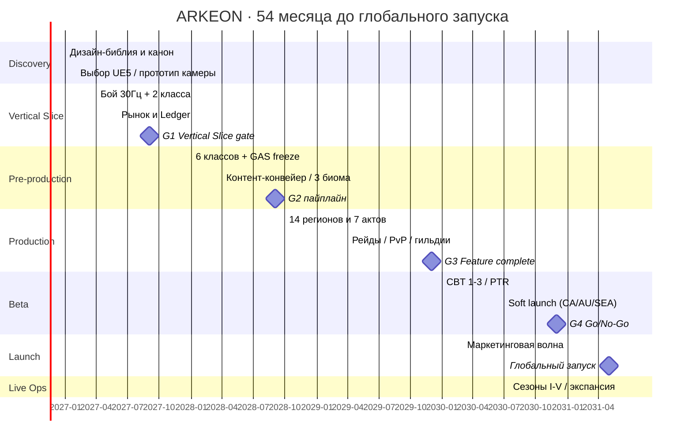

# 11 · Roadmap разработки (54 месяца)

> Владельцы: Executive Producer, Creative Director, DevOps · Версия 1.0
> Старт: **2027-Q1** · Глобальный запуск: **2031-Q2** · Горизонт документа: 2032-Q4 (Live Ops)
> Бюджет $224.68M и FTE-кривая — `12-budget.md`, `13-team.md`, `tools/financial_model.py`.

---

## 1. Фазы и врата принятия решений (Go / No-Go)

| Фаза | Период | Месяцы | Цель | Врата |
|---|---|---|---|---|
| **F0 · Discovery & Bible** | 2027 Q1 | M1–M3 | 15 документов, канон, прототип камеры и боя | **G0**: подписан GDD, бюджет, выбор движка, 65 FTE |
| **F1 · Vertical Slice** | 2027 Q2–Q4 | M4–M9 | 1 регион, 2 класса, 1 данж, рынок, 200 ботов | **G1** (M9): 60 fps mobile / 120 fps PC, p95 RTT < 80 мс, 0 дюпов — иначе стоп и пересмотр скоупа |
| **F2 · Pre-production** | 2028 Q1–Q3 | M10–M21 | 6 классов, 3 биома, пайплайн контента, GAS/Net frozen | **G2** (M21): контент-конвейер даёт регион за 8 недель, budget ±5% |
| **F3 · Production Alpha** | 2028 Q4–2029 Q4 | M22–M33 | 14 регионов, 7 актов, 8 данжей, 3 рейда, экономика, гильдии, PvP | **G3** (M33): feature-complete, 175 FTE, 1 000 внутренних тестеров |
| **F4 · Beta / Soft Launch** | 2030 Q1–Q4 | M34–M45 | CBT 1–3, PTR, локализация 14 языков, сертификация, софт-ланч | **G4** (M42): D1 ≥ 42%, crash-free ≥ 99.5%, PI в коридоре, Go на глобал |
| **F5 · Global Launch** | 2031 Q1–Q2 | M46–M51 | маркетинговая волна, день 0, масштабирование | **G5** (M51): SLO, 300K CCU, публичные отчёты |
| **F6 · Live Ops** | 2031 Q3 → 2032+ | M52+ | 5 сезонов/год, экспансия «Аур» | ежеквартальный бизнес-ревью |

**Принцип врат:** ни одна фаза не начинается, пока предыдущая не сдала измеримые критерии. Feature-freeze — **M38**; после него только багфиксы, баланс и локализация. Любое добавление системы после M38 требует подписи Executive Producer + Creative Director и публичного переноса даты (честность P3).

---

## 2. Детальный план по кварталам

| Квартал | Инженерия / сеть | Геймдизайн / контент | Арт / звук | QA / Live | Врата |
|---|---|---|---|---|---|
| **2027 Q1** | прототип QUIC, 30 Гц cell, GAS-скелет | 15 документов, канон, формулы | 6 концептов классов, ключ-арт, логограмма | device-ферма 40 устройств | G0 |
| **2027 Q2** | предсказание, AOI, ledger v1 | Зелёный Предел, Воин + Маг, 1 босс | blockout хаба, 12 VFX | 200 бот-клиентов | — |
| **2027 Q3** | рынок/order book, auth, аукцион | 1 данж, крафт T2→T4, крафт-контракты | Nanite/Lumen PC, mobile baked GI | dupe-тесты 100 сценариев | — |
| **2027 Q4** | голос, друзья, группа 5, арена 3х3 | 2 класса → 4, PvP модификаторы | звуковой логотип, Wwise | playtest ×12 | **G1 M9** |
| **2028 Q1** | Cell handoff, эхо-слои | 6 классов, 18 спеков, 144 узла | 3 биома, 4 профиля графики | перф-гейты в CI | — |
| **2028 Q2** | миграции, outbox/Kafka, ClickHouse | акты I–III, репутация, парагон | лицевой пайплайн персонажей | 380 интеграционных тестов | — |
| **2028 Q3** | анти-чит v1, matchmaking Glicko-2 | 8 данжей, дроп, заточка/перековка | сеты/руны/самоцветы | 1 000 ботов/реалм | **G2 M21** |
| **2028 Q4** | Saga кросс-реалм, DR-план | акты IV–VI, 36 территорий, налоги | Кальдера, Хребет, Топи | chaos-день | — |
| **2029 Q1** | 200v200 battleground 20 Гц | осада замка, войны гильдий, альянсы | 200+ уникальных моделей | нагрузка 4 000 ботов | — |
| **2029 Q2** | SFU voice, модерация, флаги | акт VII, рейд «Седьмая Клятва» | оркестр, VO EN/RU | рейд-плейтест 24 чел. | — |
| **2029 Q3** | CDN multi-vendor, патчер | Башня, мифик+, мировые события | Море Осколков, корабли | 220 устройств | — |
| **2029 Q4** | биллинг, entitlements, GDPR | BP, достижения, коллекции, титулы | финальный ключ-арт, стор-ассеты | **G3 feature-complete** | **G3 M33** |
| **2030 Q1** | SLO/дашборды, kill-switch | PTR-баланс, экономический лист | локализация RU/EN/DE/FR/ES | CBT-1 (5 000) | — |
| **2030 Q2** | оптимизация Medium/Low | акты I–VII полировка, онбординг | 14 языков, RTL, CJK | CBT-2 (50 000) | — |
| **2030 Q3** | рейтинг, anti-boost, DR-drill | софт-ланч контент, сезон I | стор A/B-креативы | **Soft launch** CA/AU/SEA | G4-предварительно |
| **2030 Q4** | масштабирование, очереди входа | баланс по данным софт-ланча | сертификация PEGI/ESRB/RARS | CBT-3 (200 000), **G4** | **G4 M42** |
| **2031 Q1** | 300K CCU ёмкость, канарейки | финальный патчноут, публичные вероятности | финальные трейлеры | battlesim 12 регионов | — |
| **2031 Q2** | день 0, war room 24×7 | сезон I старт, мировое голосование | live-креативы | **Global Launch** | **G5 M51** |
| **2031 Q3+** | сезонный пайплайн | сезоны II–V, экспансия «Аур» | новый регион | 5 сезонов/год | ежеквартально |

---

## 3. Контент-конвейер (критический путь)

Один регион = **8 недель**: blockout 2 → грейбокс геймплея 1 → арт 2 → свет 1 → сеть/экономика 1 → QA 1. Параллельно работают 4 команды ⇒ 14 регионов за ~9 месяцев (F3). Любая задержка арта не блокирует геймплей: серый бокс остаётся играбельным до art-pass.

| Артефакт | Владелец | Definition of Done |
|---|---|---|
| Регион | Level Designer | 3 ориентира из любой точки, 100% квестов, ≥ 3 POI, 0 блокирующих коллизий |
| Класс | Lead Game Designer | 12 навыков, 3 спека, 24 узла, DPS в ±7%, пройдены акты I–VII |
| Данж | Systems Designer | 4 сложности, босс с 3+ механиками, таймер, личный лут, p95 кадра |
| Рейд | MMORPG Systems Designer | 4 фазы, enrage, лут по вкладу, 24 плейтестера |
| Экономический тир | Economy Designer | faucet/sink в симуляции, спавн-точки, цена станции |
| Локализация | Community + Localization Lead | псевдолокализация, RTL, ≤ 140% длины строки |

---

## 4. Зависимости и буферы

| Критическая зависимость | Буфер |
|---|---|
| GAS/Net API должен быть заморожен к M21 | 6 недель резерва + версионирование `config_versions` |
| Мобильная графика (4 профиля) | device-ферма с M1, перф-гейты с M6, «Лёгкий режим» как страховка |
| Ledger/рынок — основа экономики | выделенная команда в F1, 100% dupe-тестов до G1 |
| Локализация 14 языков | строки не хардкодятся, TMS с M10, VO записывается в F4 |
| Сертификация сторов/рейтингов | юристы с M30, подача за 12 недель до софт-ланча |
| Маркетинговая волна | креативы готовы за 6 мес, A/B с M40, budget заложен в Y4/Y5 |
| Риск срыва скоупа | **фича-фриз M38**, «вырезать, а не переносить», публичный патчноут |

**Резерв:** 12% бюджета ($24.07M) + 6 недель календарного буфера перед G5. При срыве G4 глобальный запуск переносится, но **никогда** не выпускается билд без crash-free ≥ 99.5% и экономического коридора.

---

## 5. Софт-ланч и обучение на данных (M34–M45)

| Этап | Регионы | Аудитория | Главный вопрос | Метрика Go |
|---|---|---|---|---|
| CBT-1 | EU (закрытый NDA) | 5 000 | «Бой ощущается?» | 60 fps, 80% «понравился отклик» |
| CBT-2 | EU + NA | 50 000 | «Игрок понимает экономику?» | ≥ 60% совершили сделку на рынке |
| Soft launch | CA / AU / SEA / NZ | 300 000 | «Удержание и монетизация честны?» | D1 ≥ 42%, D7 ≥ 18%, PI ∈ [94,108] |
| CBT-3 | + CIS / BR / TR | 200 000 | «Локализация и сеть?» | crash-free ≥ 99.6%, p95 RTT по SLO |
| G4 | — | — | «Запускаем?» | 100% критериев `15-launch.md` §3 |

Из софт-ланча **не переносятся** предметы и Серебро в глобальный запуск (чистый старт экономики), но переносятся косметика, entitlements и титулы первопроходцев — это честно и объявляется заранее.

---

## 6. Live Ops после запуска (M52+)

| Ритм | Событие |
|---|---|
| Еженедельно | hotfix, экономический лист, ротация мифик+ аффиксов, осада территорий |
| 10 недель | новый сезон: BP 100 tier, сюжетный дроп, мировое голосование, мягкий сброс рейтинга |
| 3 месяца | баланс-патч классов (только по порогам `05-classes.md` §9), новый данж или режим |
| 6 месяцев | крупный контент-патч: новый босс, коллекция, QoL |
| 12 месяцев | экспансия «Аур»: +10 уровней, новый регион, 7-й престиж-класс, новая Клятва |
| Постоянно | 24×7 on-call, ежемесячные chaos-учения, ежеквартальный публичный отчёт о состоянии игры |

**Кадровый переход:** с M52 команда снижается с пиковых 252 до ~150 FTE «live-ops ядра»; высвобождённые силы переходят в экспансию, а не в «поддержку одного билда» (`13-team.md`).

---

## 7. Критерии приёмки roadmap

- [ ] Каждая фаза имеет измеримые врата и владельца; G1 и G4 — обязательные «стоп-точки».
- [ ] 14 регионов, 6 классов, 8 данжей, 3 рейда, 8 PvP-режимов, 14 языков уложены в M1–M45.
- [ ] Feature-freeze M38 зафиксирован в CI: после него мерж новых систем требует двух подписей.
- [ ] Бюджет по годам из `tools/financial_model.py` совпадает с `data/canon.json` ($224 680 000).
- [ ] Публичный календарь сезонов и патчноутов за 14 дней существует до глобального запуска.
