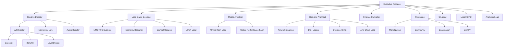

# 14 · Состав команды и организационная структура

> Владельцы: Executive Producer, Creative Director, HR/Leadership · Версия 1.0
> Численность: `13-budget.md` §2.1, `tools/financial_model.py`; пик **252 FTE** в M38–M44.

---

## 1. Студийная модель: 16 ролей → владельцы

Пользовательская «студия AAA-класса» из 16 ролей зафиксирована как **совет владельцев направлений (Leads Council)**. Каждая роль имеет имя-должность, зону принятия решений и KPI.

| № | Роль (как в брифе) | Должность в ARKEON | Зона решений | KPI |
|---|---|---|---|---|
| 1 | **Creative Director** | Creative Director (CD) | видение, опоры P1–P3, лор, бренд, финальное veto по фичам, нарушающим опоры | целостность канона, NPS нарратива |
| 2 | **Executive Producer** | Executive Producer (EP) | скоуп, бюджет, врата G0–G5, приоритеты, публичные обязательства | burn ±5%, соблюдение врат |
| 3 | **Lead Game Designer** | Lead Game Designer (LGD) | ядро боя, петли, формулы, классы, баланс | TTK, DPS-разброс ≤ ±7% |
| 4 | **MMORPG Systems Designer** | MMORPG Systems Designer | социальные системы, гильдии, рейды, зоны закона, ранги | доля в гильдии D14 ≥ 48% |
| 5 | **Economy Designer** | Economy Designer | faucet/sink, рынок, крафт, контроллер инфляции, анти-RMT | PI 100±6, crafted ≥ 92% |
| 6 | **Mobile Architect** | Mobile Architect | 4 профиля графики, память/тепло/батарея, device farm | 60 fps Medium, crash-free ≥ 99.6% |
| 7 | **Backend Architect** | Backend Architect | микросервисы, ledger, БД, консистентность | 0 дюпов, market p99 < 250 мс |
| 8 | **Network Engineer** | Network Engineer | QUIC, AOI, 30 Гц тик, lag compensation, 200v200 | p95 RTT по SLO, ≤ 60 kbps |
| 9 | **Unity/Unreal Developer** | Unreal Tech Lead (C++/GAS) | клиентский движок, GAS, репликация, пайплайн | p95 frame time, 0 client-authority |
| 10 | **UI/UX Designer** | UI/UX Lead | HUD, правило трёх тапов, доступность, магазин | WCAG 2.2 AA, «3 тапа» |
| 11 | **Concept Artist** | Art Director (Concept) | ключ-арт, визуальный код 7 Клятв, палитра | approved art bible |
| 12 | **3D Artist** | 3D/VFX Lead | Nanite-ассеты, LOD, Niagara, разрушаемость | 4 профиля без потери читаемости |
| 13 | **Level Designer** | Level Design Lead | 14 регионов, навигация, 3 ориентира, AOI-плотность | регион за 8 недель |
| 14 | **DevOps Engineer** | DevOps/SRE Lead | K8s, CDN, CI/CD, DR, observability, kill-switch | 99.95% uptime, RPO 5 мин |
| 15 | **Monetization Designer** | Monetization Lead | каталог, BP, цены, хартия честного F2P | конверсия 4.2%, **0 нарушений хартии** |
| 16 | **Community Manager** | Community Lead | комьюнити, модерация, 14 языков, патчноуты, апелляции | рейтинг сторов ≥ 4.3, апелляция < 24 ч |

**Дополнительно к совету (обязательные лиды):** Audio Director (Wwise), Localization Lead, QA Lead, Anti-Cheat Lead, Security/DPO, Analytics Lead, Legal Counsel, Finance Controller. Они входят в совет с правом совещательного голоса и правом **veto** по своему контуру соответствия.

---

## 2. Организационная схема

**Принцип «одна фича — один владелец»:** каждая система из `07-mechanics.md` имеет ровно одного DRI в этом совете; пересечения разрешаются RACI (ниже).

---

## 3. Отделы и численность (пик M38–M44 = 252 FTE)

| Отдел | Пик FTE | Состав | Лид |
|---|---|---|---|
| Engineering: Client (UE5/C++/GAS/UI-engine) | 42 | 18 C++ gameplay, 8 GAS, 6 UI-engine, 5 render, 5 tools | Unreal Tech Lead |
| Engineering: Server / Network | 38 | 14 cell/combat C++, 10 Go-сервисы, 6 Rust gateway/market, 5 net/protocol, 3 DB | Backend Architect + Network Engineer |
| DevOps / SRE / Security | 18 | 6 K8s, 4 CDN/release, 4 observability, 2 security, 2 DPO-support | DevOps Lead |
| Art: Concept / 3D / VFX / Level | 55 | 8 concept, 22 3D, 9 VFX, 12 level, 4 lighting | Art Director + Level Lead |
| Design | 34 | 6 core combat, 6 systems, 5 economy, 5 class/balance, 4 level-design, 4 UX-writing, 4 live-content | Lead Game Designer |
| UI/UX | 12 | 6 UI-дизайн, 4 research/accessibility, 2 UI-art | UI/UX Lead |
| Audio + Narrative + Localization | 16 | 4 audio, 4 narrative, 6 localization, 2 VO-продакшн | Audio Director |
| QA / Device farm | 28 | 14 manual, 8 automation, 4 perf, 2 certification | QA Lead |
| Analytics / Anti-Cheat | 10 | 5 data, 3 ML risk, 2 replay tooling | Analytics Lead + Anti-Cheat Lead |
| Production / Leadership | 9 | EP, CD, 3 producers, 2 PM, HR, finance | Executive Producer |
| Publishing / Monetization / Community | 30 | 6 monetization, 10 community/moderation 14 языков, 6 UA/PR, 4 creator/esports, 4 support | Community Lead + Monetization Lead |
| Legal / Finance / HR (overhead) | 10 | 3 legal/DPO, 3 finance, 2 HR, 2 office | Finance Controller |
| **Итого** | **252** | | |

**Аутсорс:** ≤ 18% от арт-продакшна (пропсы, часть VO, 2D-иконки) и ≤ 10% QA (device farm); **никогда** не отдаются: GAS/сетевой код, ledger, баланс-коэффициенты, лор-канон, финальный art-direction и модерация чата. Партнёры: Epic (UE лицензия/консультации), 2 CDN-вендора, anti-cheat SDK-вендор, аудитор хартии честного F2P, оркестр и VO-студии, локализационный TMS, облачный провайдер.

---

## 4. RACI на ключевые решения

| Решение | Responsible | Accountable | Consulted | Informed |
|---|---|---|---|---|
| Изменить боевую формулу | Lead Game Designer | Creative Director | Economy, Backend, Analytics | весь совет + PTR |
| Ввести/убрать фичу | DRI системы | Executive Producer | CD, LGD, DevOps | комьюнити (патчноут) |
| Изменить faucet/налог | Economy Designer | Executive Producer | Backend, Analytics, Community | игроки (Лист экономики) |
| Добавить SKU в магазин | Monetization Lead | Creative Director | Legal, Community, Economy | игроки (каталог) |
| Баланс-патч класса | Combat/Balance | Lead Game Designer | Analytics, Community | PTR + патчноут за 14 дн. |
| Бан/анти-чит политика | Anti-Cheat Lead | Backend Architect | Legal/DPO, Community | игрок (апелляция) |
| Go/No-Go врата | Executive Producer | Совет владельцев | все лиды | инвесторы, комьюнити |
| Мировое голосование сезона | Narrative + Community | Creative Director | Systems, Economy | все игроки |
| Инцидент P1 | DevOps on-call | Backend Architect | DPO, Community | статус-страница |

---

## 5. Найм по волнам

| Волна | Период | +FTE | Кого берём первым |
|---|---|---|---|
| W0 | M1–M3 | 65 | 16 лидов совета + ядро GAS/Net/Ledger + 2 концепт-художника |
| W1 | M10–M18 | +55 | 6 оставшихся классов, пайплайн контента, SRE, первые QA |
| W2 | M22–M33 | +55 | level/art-команды ×4, рейд-дизайн, аналитика, анти-чит |
| W3 | M34–M42 | +42 | локализация 14 языков, комьюнити/модерация, UA, поддержка 24×7 |
| W4 | M43–M44 | +35 | «launch surge»: war-room, scale-инженеры, сертификация |
| **Пик** | **M38–M44** | **252** | — |
| W5 | M52+ | −102 | переход к Live Ops ядру ~150 FTE; высвобождённые → экспансия «Аур» |

**Ключевые наймы-риски:** Backend Architect и Network Engineer — до M2 (иначе G1 срывается); Economy Designer — до M3 (ledger закладывается в вертикальный срез); Mobile Architect — до M2 (4 профиля графики); Community Lead — до M30 (софт-ланч).

---

## 6. Режим работы и культура

- **Гибридные хабы:** Варшава / Милан / Берлин + удалённо (EU/US/СНГ), 4 часовых пояса, «core hours» 11:00–16:00 CET.
- **Ритм:** 2-недельные спринты, еженедельный Leads Council, ежемесячный Playtest Day (все 252 играют в текущий билд), ежеквартальный ревью опор P1–P3.
- **On-call:** 24×7 ротация SRE + Backend + Community, 3 смены по 8 ч, runbook на каждый сервис, postmortem без поиска виноватых за 72 ч.
- **Культура честности:** любой сотрудник может поднять «P3-флаг», если фича даёт преимущество за деньги; флаг рассматривается на совете в течение 48 ч и не может быть проигнорирован.
- **Прозрачность:** патчноуты за 14 дней, публичные вероятности, экономический лист, «Лист честности» — обязанности Community Lead, а не «по желанию маркетинга».
- **Развитие:** 5% рабочего времени на R&D (прототип камеры, VFX, инструменты), внутренний «инкубатор сезона» для дизайнеров.

---

## 7. Критерии приёмки команды

- [ ] Все 16 ролей из брифа имеют назначенного владельца, KPI и зону решений; совет собирается еженедельно с M1.
- [ ] Численность по отделам на пике = 252 и совпадает с `13-budget.md` и `tools/financial_model.py`.
- [ ] RACI покрывает 9 критических решений; для P1-инцидента есть круглая ротация 24×7.
- [ ] Аутсорс не касается GAS/Net/Ledger/баланса/канона/модерации.
- [ ] План W0–W5 привязан к вратам `11-roadmap.md`; ключевые наймы закрыты до M3.
